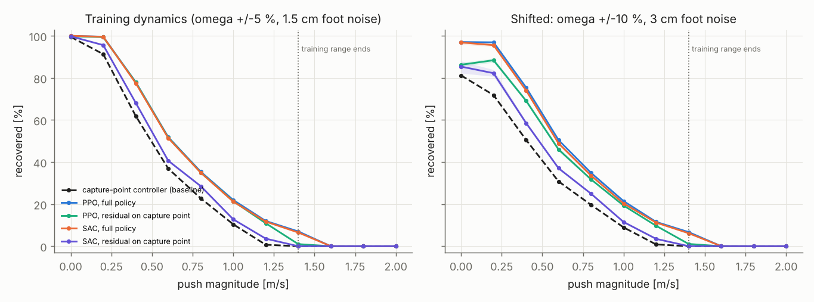
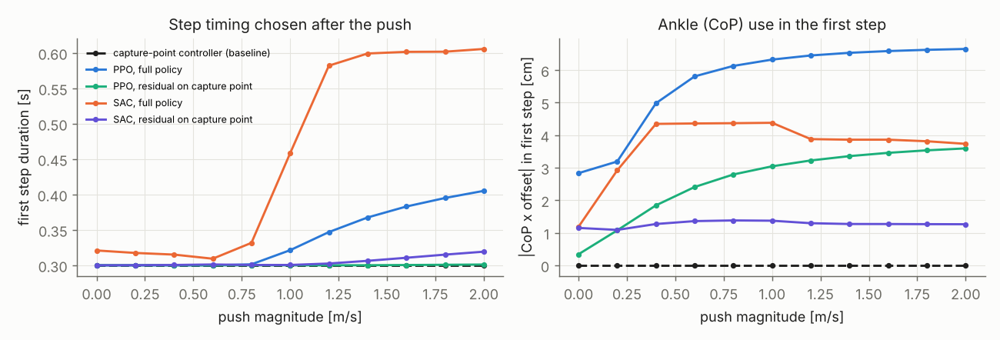
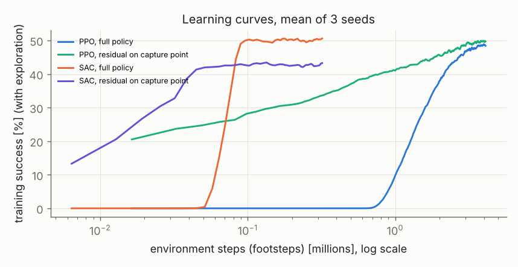

# Push Recovery RL: PPO and SAC Against a Capture-Point Controller

A humanoid gets shoved and has to step to stay up. This repo trains PPO and SAC, both written from scratch in PyTorch, to choose where to put the next foot, when to put it down and how to use the ankle, and compares them with the controller a humanoid team would actually start from, divergent-component-of-motion (capture-point) stepping. Each algorithm is trained two ways, as a full policy and as a residual correction on top of the capture-point controller, with three seeds each, and every policy is scored on the same 2,000 pushes per push level, first on the training dynamics and then on a model it has not seen.

The learned policies raised the recovery rate averaged over 0 to 1.4 m/s pushes from 40 % (capture point) to 51 % (PPO and SAC full policies). The larger gain was robustness. With the pendulum frequency off by up to 10 % and 3 cm foot placement noise, the capture-point controller recovered only 81 % of episodes with no push at all, while the full policies held 97 %. Residual policies trained fastest but stayed close to the baseline they correct, including its sensitivity to model error.

The model is a linear inverted pendulum, not a humanoid. The numbers say what a step-level policy can learn about timing and placement, not what a G1 or an Optimus would do.



## The environment

One decision per step on a 3D linear inverted pendulum (LIPM) with CoM height $z_0 = 0.9$ m, so $\omega = \sqrt{g/z_0} = 3.30$ rad/s. Within a step the CoM follows the closed-form solution about the centre of pressure $p$,

$$c(t) = p + (c_0 - p)\cosh\omega t + \frac{\dot c_0}{\omega}\sinh\omega t,$$

and at touchdown the swing foot becomes the stance foot. The lateral axis is mirrored by stance side, so one policy serves both legs.

| | |
|---|---|
| Action (per step) | foot x in [-0.45, 0.60] m, foot y outward in [0.10, 0.45] m (no crossover), step time T in [0.30, 0.70] s, CoP x in [-5, 10] cm, CoP y in [-3, 3] cm |
| Observation | CoM position and velocity relative to the stance foot, step index |
| Push | velocity impulse in a random horizontal direction at the start, 0 to 1.4 m/s in training |
| Hidden from the controller | $\omega$ randomized by ±5 % per episode, 1.5 cm foot placement noise, 0-30 ms touchdown delay, 5 mm CoP noise |
| Kinematics | foot lands at most 0.55 m from the CoM; a stance foot more than 0.75 m from the CoM (mid-step or touchdown) is a fall |
| Episode | 8 steps. Success = no fall and the DCM within 12 cm of where steady in-place stepping puts it |

The reward is $1 - 0.5\lVert v\rVert - 0.5\lVert\xi - \xi^*\rVert - 0.2(T - 0.4)^2$ per step, −10 for a fall, and a terminal bonus $5\exp(-e_\xi^2/0.01)$ on the final DCM error. The baseline places the foot where the DCM, propagated with the nominal $\omega$, would come to rest, with the CoP at the foot centre and $T = 0.3$ s.

PPO uses 1,024 parallel environments, 16-step rollouts, GAE ($\lambda = 0.95$), clipping 0.2, 8 epochs, observation normalization and a linearly decayed learning rate, for 4.1M footsteps. SAC uses twin Q networks, target networks, automatic entropy tuning and 16 gradient updates per batch of 128 environment steps, for 320k footsteps. Residual variants execute $a = \mathrm{clip}(a_{cp}(s) + 0.3\,a_\pi(s))$.

## How to run

```bash
pip install -r requirements.txt
./scripts/run_all.sh                  # tests, training (~25 min on 2 cores), evaluation, plots
python3 scripts/evaluate.py && python3 scripts/plot.py    # re-score the committed policies only
python3 -m pytest -q tests            # 9 tests, ~40 s
docker build -t push-recovery-rl . && docker run --rm push-recovery-rl
```

## Results

### Recovery rate (mean over pushes 0 to 1.4 m/s, 3 seeds)

| Policy | Training dynamics | Shifted dynamics | At 1.0 m/s | At 1.4 m/s |
|---|---|---|---|---|
| Capture-point controller | 40.4 % | 33.0 % | 10.4 % | 0 % |
| PPO, full policy | 50.7 % | 49.3 % | 22.0 % | 7.0 % |
| PPO, residual | 49.6 % | 44.0 % | 21.4 % | 1.0 % |
| SAC, full policy | 50.4 % | 48.3 % | 21.2 % | 6.5 % |
| SAC, residual | 43.6 % | 37.9 % | 12.8 % | 0 % |

On the training dynamics the three seeds of each variant agreed within 0.3 percentage points. On the shifted model they agreed within 0.8 points for the full policies and within 1.5 for the residual ones. No policy recovered any push of 1.6 m/s or more.

### The curve is mostly a direction story

`scripts/direction.py` splits 8,000 pushes at 0.6 m/s by direction.

| Push direction | Capture point | PPO (seed 0) |
|---|---|---|
| Forward | 93 % | 100 % |
| Backward | 94 % | 100 % |
| Diagonal | 3-52 % | 21-83 % |
| Toward the swing leg | 0 % | 11 % |
| Toward the stance leg | 0 % | 0 % |

Sagittal pushes are nearly always recovered. Lateral ones are not, because the swing foot cannot cross over and the outward step is capped at 0.45 m, while a 0.6 m/s lateral push puts the DCM about 0.5 m out by touchdown ($0.6/\omega \cdot e^{\omega T}$ with $T = 0.3$ s). The learned policies win most of their margin on the diagonals.

### What the policies learned



The full policies took longer first steps as the push grew (PPO from 0.30 to 0.41 s, SAC from 0.32 to 0.61 s), the opposite of the baseline's reasoning that short steps limit DCM growth. A longer step lets the CoM travel further before touchdown, so the foot can land further away while staying within reach of the CoM, which is what large pushes need. Both full policies also used the ankle, moving the CoP 1 to 7 cm along x in the first step, which the baseline never does.

### Training cost



| | Footsteps | Wall time per seed |
|---|---|---|
| PPO, full / residual | 4.1M | 116 s / 128 s |
| SAC, full / residual | 320k | 331 s / 234 s |

SAC reached PPO's final success rate with 13 times fewer environment steps and took 2 to 3 times longer in wall time on this CPU, because it does 16 gradient updates per batch of steps. The residual policies started near the baseline (20 % and 13 % training success at their first logged iteration, against 0 % for the full policies until about 50k SAC or 600k PPO steps). The wall times were measured while other jobs shared the machine and are only indicative.

## What worked

Domain randomization, even narrow, bought robustness that a nominal-model controller cannot have. The capture-point rule is exact for the nominal pendulum and pays for every percent of frequency error, while the policies were trained on ±5 % and lost little at ±10 %.

Putting the step time and the CoP in the action space. The baseline's fixed timing is the main thing the policies changed, and the direction breakdown shows where that helped.

Scoring every policy on the same fixed pushes with three seeds. It made 0.2-point differences between seeds visible as noise and the 10-point gap to the baseline visible as real.

## What did not work

Residual policies did not keep up at large pushes. With a correction scale of 0.3 on normalized actions, the residual PPO could not move the step time or the foot far enough from the baseline's choice and recovered 1 % of 1.4 m/s pushes against 7 % for the full policy. They also inherited the baseline's sensitivity to the shifted model (86 % against 97 % with no push). The scale is a trade between safety and authority, and 0.3 was too tight for this task.

SAC as a residual was the weakest learner, 43.6 % against 49.6 % for PPO as a residual, and its training curve flattened at about 43 % after 50k steps. I did not isolate the cause. The likely one is the entropy target, which keeps a 5-dimensional correction noisy when most of the useful corrections are small.

The first version of the environment had a sign error in the lateral mirroring at touchdown, which broke the symmetry between left and right steps. `test_lipm_closed_form_matches_numerical_integration` now checks the frame change against an RK4 integration.

"Survived 8 steps" was the first success criterion, and it counted episodes that were still drifting toward a fall. Success now also requires the DCM to be back within 12 cm of the periodic gait.

The first randomization range was ±15 % on $\omega$. That made the nominal-model baseline unreliable even without pushes (at ±10 % it already recovers only 81 % of unpushed episodes), so training uses ±5 % and ±10 % became the shifted test.

The baseline's step time was first set to 0.4 s, and it fell in 22 % of episodes with no push. The DCM grows by $e^{\omega T}$ per step, so a longer step amplifies model and timing errors more, and 0.3 s (the minimum) was the best of 0.30, 0.35 and 0.40 s.

SAC drew its minibatch indices from NumPy's unseeded global random generator, so no SAC run could be reproduced from its seed. The code review found it. The sampler is now seeded from the run's seed, a test trains two short SAC runs with one seed and requires identical policies (it fails on the old sampler), and every policy in `results/` was retrained. PPO's numbers did not move. SAC's moved by at most 0.6 points.

The first evaluation averaged the per-step behavior statistics over the wrong axis, so "first step duration" was actually one episode's mean step time. The behavior plot looked flat, which is how it was caught.

## Topics from the list used here

- Legged robots and humanoids (13C): linear inverted pendulum model, capture point and divergent component of motion, footstep placement, push recovery and disturbance rejection, RL-based locomotion, sim-to-real considerations through randomized dynamics.
- Reinforcement learning (5C): policy gradients, actor-critic methods, PPO, SAC, temporal-difference learning (SAC critics), exploration through entropy regularization, reward shaping, domain randomization, residual RL as a correction to a conventional controller.
- Deep learning (5B): multilayer perceptrons, orthogonal initialization, Adam, learning-rate schedules, observation normalization, gradient clipping.
- Robot dynamics (2A, 2C): closed-form ODE solutions, underactuated and legged-robot dynamics.
- Nonlinear and hybrid control (1E): a hybrid step-to-step map with discrete touchdown events.
- Decision-making under uncertainty (1H, 4D): Markov decision processes, Monte Carlo evaluation.
- Learned policies under distribution shift (13F, 5A): evaluation on shifted dynamics and noise.
- Software engineering (8): Python, PyTorch, NumPy, pandas, Matplotlib, pytest, vectorized simulation of thousands of environments, seed management, statistical comparison across seeds, automated report generation, Docker, CI, Git.
- System identification and experiments (14): ablation (full vs residual), benchmarking against a tuned baseline, Monte Carlo evaluation, reproducible experiment logs.
- RoboJackets software training slides: Ubuntu, Docker, Git.

## What I learned

A learned policy should be compared with the controller it would replace, tuned properly. The capture-point baseline needed its step time fixed before the comparison meant anything.

The headline number hides the structure. The recovery curve looks like a smooth capability limit, and it is really a kinematic limit on lateral stepping that no controller in this action space can get around.

Residual RL changes the training problem more than the answer. It starts safe and learns fast, and its final behavior stays close to what it is correcting, good and bad.

Sample efficiency and wall-clock efficiency are different measurements. SAC used far fewer environment steps and far more compute.

## Limitations

The LIPM has constant CoM height, a point foot with a CoP box instead of a support polygon, no swing-leg dynamics, no angular momentum and instantaneous double support. Three seeds per variant is the minimum for a spread. Everything was trained and evaluated in the same simplified simulator, so the shifted test is a sanity check on robustness, not a sim-to-real result. The natural next steps are crossover steps or a hip strategy for lateral pushes, and a full-body simulation with these policies as a footstep layer under a whole-body controller.

## Resume entry

**Humanoid Push Recovery with Reinforcement Learning** | Python, PyTorch, NumPy, pytest, Docker

- Raised push-recovery success on a stepping humanoid model (3D linear inverted pendulum with foot placement, step timing and ankle CoP actions) from 40 % to 51 % averaged over 0-1.4 m/s pushes by training PPO and SAC written from scratch in PyTorch, benchmarked against a tuned capture-point controller over 3 seeds and 2,000 pushes per level.
- Kept 97 % recovery of unpushed episodes under a shifted model (±10 % pendulum frequency, 3 cm foot noise) where the capture-point controller fell to 81 % and residual policies built on it reached 85 to 86 %, and traced most remaining failures to lateral pushes (0-11 % recovered at 0.6 m/s against 93-100 % for sagittal pushes).
- Matched PPO's final recovery rate with SAC using 13 times fewer environment steps, and showed that residual policies trained fastest but were capped by their correction authority (1 % against 7 % recovery at 1.4 m/s).

## Repository layout

```
prl/        env.py (vectorized LIPM stepping environment, capture-point baseline), agents.py (PPO, SAC, residual wrapper, evaluation)
scripts/    train.py, evaluate.py, direction.py, plot.py, run_all.sh
tests/      pytest suite (closed-form LIPM vs RK4, baseline gait, reach projection, falls, normalizer, SAC log-prob and reproducibility, residual identity, PPO smoke)
results/    trained policies (12 small pickles), CSVs, figures, summary.md
```
